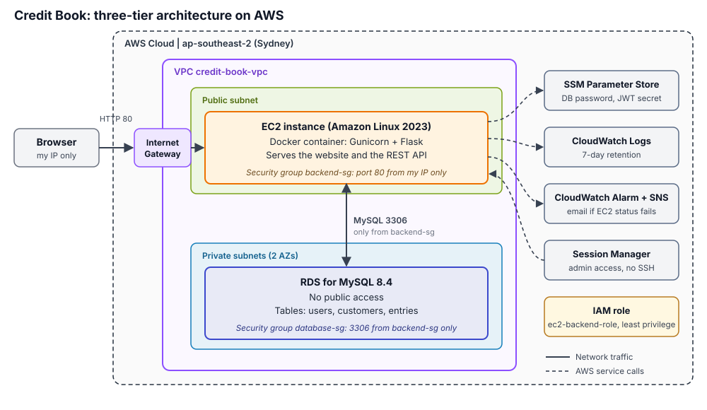
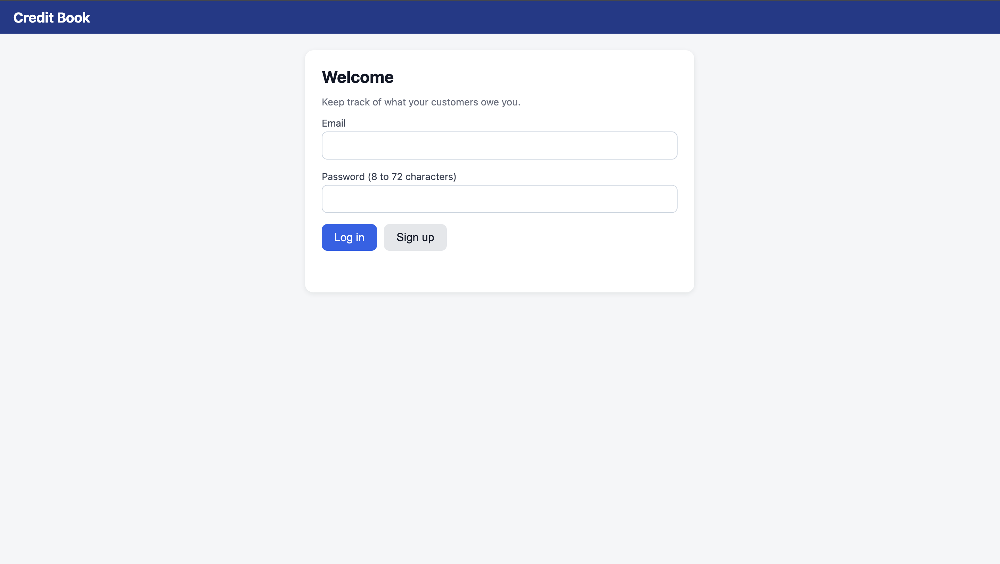
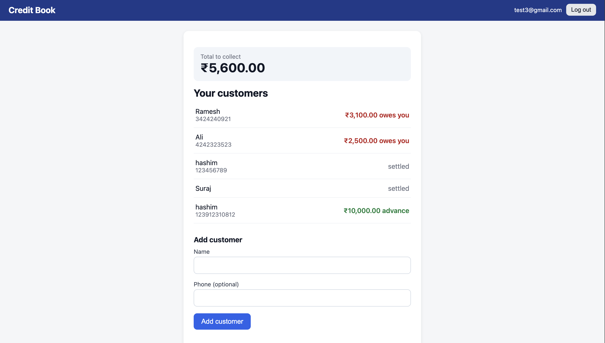
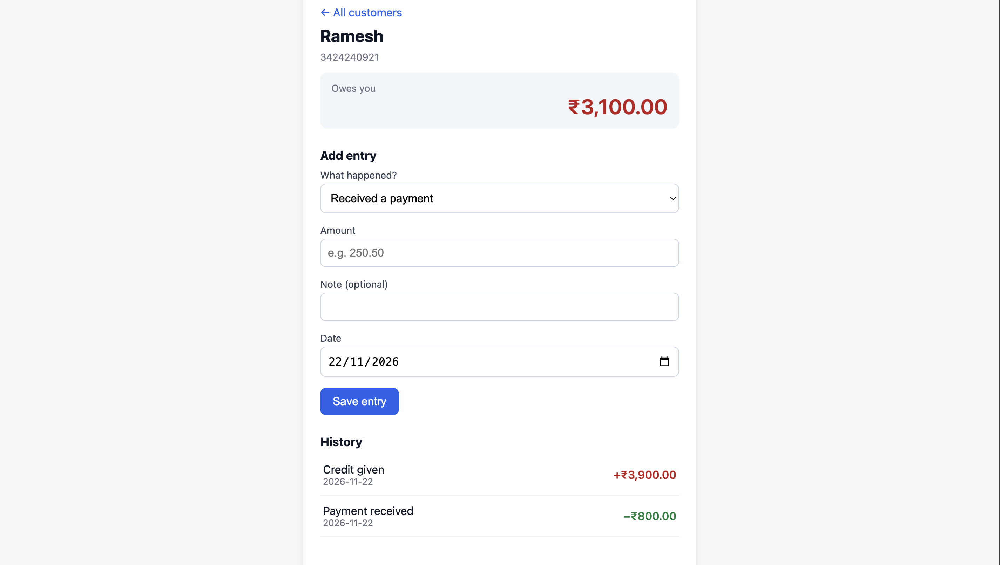
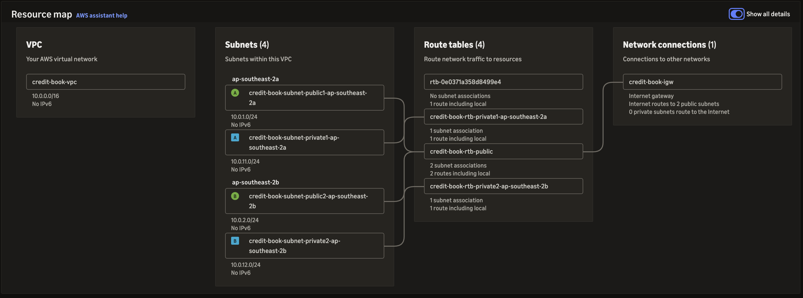
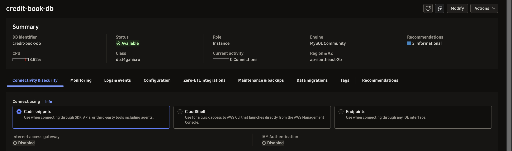
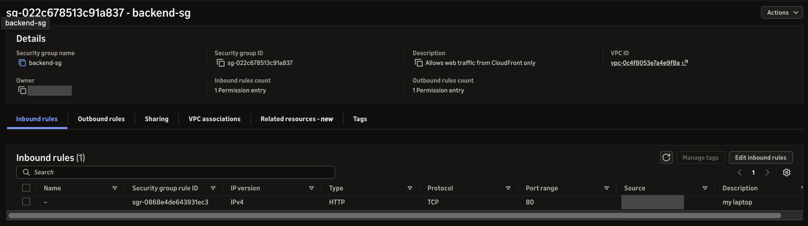
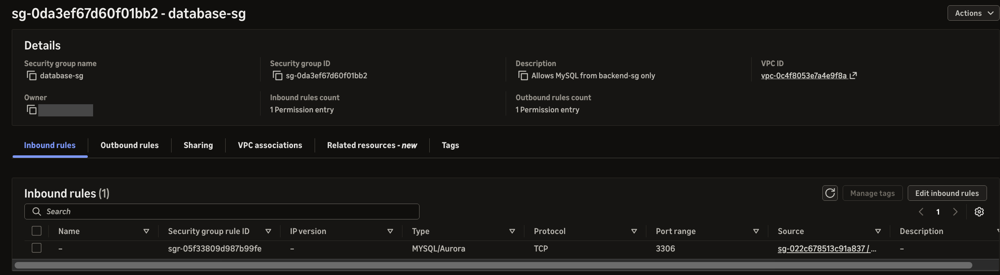
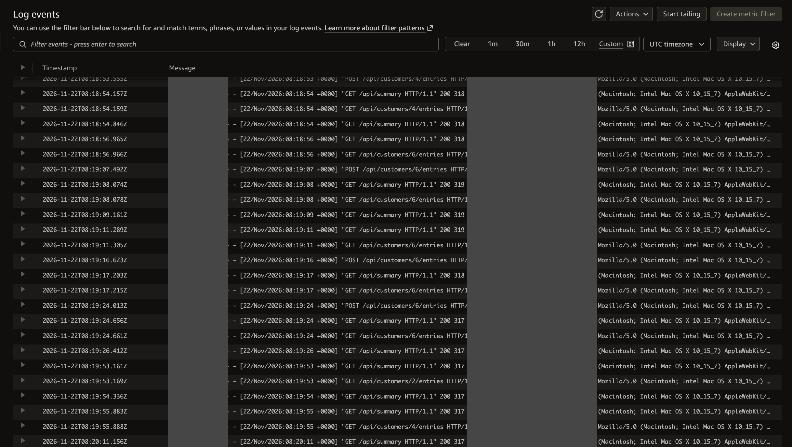
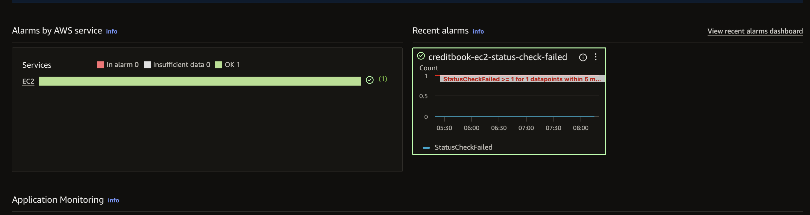

<h1 align="center">Credit Book</h1>
<p align="center"><b>A three-tier web app on AWS, built and secured by hand.</b><br>
A digital <i>udhaar khata</i> for shopkeepers, used here to practise real cloud engineering.</p>

<p align="center">
  
  
  
  
  
  
</p>

<p align="center">
  
</p>

**Contents:** [Highlights](#highlights) · [Skills demonstrated](#skills-demonstrated) · [Architecture](#architecture) · [Security](#security-design) · [Monitoring](#monitoring) · [Cost](#cost-control) · [Limitations](#known-limitations-and-roadmap) · [Docs](#documentation)

## Highlights

- **Private database.** MySQL runs in private subnets with no public access. Only the backend's security group can reach it on port 3306.
- **No SSH, no stored secrets.** Server access is through Session Manager. Passwords and signing keys live in Parameter Store and are read through a least-privilege IAM role.
- **Secure by design.** bcrypt password hashing, JWT login, parameterised SQL, input validation, and an ownership check on every request, so one shop can never see another shop's data.
- **Observable.** Container logs stream to CloudWatch, and an alarm emails me through SNS if the server fails its status check.
- **Cost-aware.** No NAT Gateway or load balancer, 7-day log retention, and a documented teardown. Roughly **$0.035 per hour** while running.
- **Honest documentation.** Known gaps, trade-offs and a real troubleshooting log are written down, not hidden.

> **Live demo:** not public, on purpose. The server's firewall accepts traffic only from my own IP address. I am happy to demo it on a call.

## Skills demonstrated

| Skill | Where it shows up |
|---|---|
| Networking | VPC with public and private subnets, route tables, Internet Gateway, deliberate choice to avoid a NAT Gateway |
| Security | Security group chaining, private database, IAM least privilege, secrets management, no SSH |
| Compute | EC2 with Docker, Gunicorn, container restart policy, scripted redeploys |
| Databases | RDS MySQL in a DB subnet group, schema design, parameterised queries, `DECIMAL` for money |
| Monitoring | CloudWatch Logs with retention, CloudWatch alarm, SNS email alerts |
| Cost management | Hourly cost estimates, stop/teardown plan, budget-driven design decisions |
| Troubleshooting | Written root-cause notes for 7 real problems ([log](docs/troubleshooting.md)) |
| Application | Python REST API, JWT auth, vanilla JavaScript single-page UI |
| Documentation | Architecture, security, cost, deployment guide, API reference |

## Architecture

The diagram at the top shows the whole system. In one sentence: the browser talks to one Flask container on EC2. The container reads secrets from Parameter Store using an IAM role, and talks to a MySQL database that sits in private subnets and accepts connections only from the backend's security group.

| Layer | Technology |
|---|---|
| Frontend | HTML, CSS, vanilla JavaScript (served by Flask) |
| Backend | Python 3.12, Flask, Gunicorn, Docker |
| Database | Amazon RDS for MySQL 8.4 (private subnets) |
| Auth | bcrypt password hashes, JWT (HS256, 8-hour expiry) |
| AWS | VPC, subnets, Internet Gateway, route tables, security groups, EC2, RDS, IAM, SSM Parameter Store, Session Manager, CloudWatch Logs and Alarms, SNS |

Full explanation, the login sequence diagram, and design trade-offs: [docs/architecture.md](docs/architecture.md)

## What the app does

- Sign up and log in
- Add customers
- Record **credit given** and **payments received** for each customer
- See each customer's balance and a "total to collect" figure
- Every user sees only their own data

API reference: [docs/api.md](docs/api.md)

## Security design

- **Network:** the database is in private subnets, "Publicly accessible" is off, and `database-sg` allows 3306 **only from `backend-sg`**. Port 80 on the backend is open only to the developer's IP.
- **Access:** no SSH and no key pairs, only Systems Manager Session Manager.
- **Secrets:** the DB password and JWT key are SecureString parameters. Nothing sensitive is in the code, the Docker image, or Git.
- **IAM:** the instance role can read only `/creditbook/*` parameters and write only to one log group.
- **Passwords:** bcrypt with a per-user salt. Login returns the same error for "wrong email" and "wrong password".
- **Injection and XSS:** all SQL uses placeholders; the UI renders text with `textContent`, never `innerHTML`.
- **Validation:** email format, password length (8 to 72 bytes, the bcrypt limit), money as `Decimal` with at most 2 decimals.
- **Access control:** changing a customer ID in the URL to someone else's returns `404`.

Known gaps and fixes: [docs/security.md](docs/security.md)

## Monitoring

- Container output, including one line per HTTP request, goes to **CloudWatch Logs** (`/creditbook/backend`, 7-day retention).
- A **CloudWatch alarm** watches the EC2 status check and emails through **SNS** if it fails.

## Cost control

- No NAT Gateway, no load balancer, small single instances.
- Short log retention and a documented teardown order.
- Estimated running cost: about **$0.035/hour** for EC2 and RDS together.

Details: [docs/cost.md](docs/cost.md)

## Repository layout

```
backend/        Flask API, Dockerfile, requirements
frontend/       index.html, style.css, app.js (single-page UI)
database/       schema.sql (reference schema)
docs/           architecture, security, cost, deployment, API, troubleshooting
deploy.sh       one-command redeploy on the EC2 server
```

## Known limitations and roadmap

An honest list of what this project does **not** do yet, and what I would do next:

| Limitation | Next step |
|---|---|
| HTTP only (no TLS) | CloudFront with a free certificate, or ALB + ACM + a domain |
| Single EC2 instance | Application Load Balancer + Auto Scaling group |
| Single database instance | Multi-AZ RDS and a backup review |
| Infrastructure created by hand in the console | Rebuild as Terraform |
| Manual deploys (`deploy.sh`) | GitHub Actions pipeline |
| App connects as the DB admin user | Dedicated least-privilege database user |
| No login rate limiting | Throttling or AWS WAF |

**CloudFront:** I designed a CloudFront + private S3 setup ([docs/cloudfront-design.md](docs/cloudfront-design.md)), but AWS blocked creating distributions on my new account pending account verification, so the app is served directly from EC2 for now.

## Documentation

| Document | What it covers |
|---|---|
| [docs/architecture.md](docs/architecture.md) | Components, security group chain, request flow, design decisions |
| [docs/security.md](docs/security.md) | Controls in place and known gaps |
| [docs/cost.md](docs/cost.md) | Cost estimates, savings decisions, teardown order |
| [docs/deployment.md](docs/deployment.md) | How to rebuild the environment step by step |
| [docs/api.md](docs/api.md) | Endpoints, examples, error format |
| [docs/troubleshooting.md](docs/troubleshooting.md) | Real problems, causes, fixes and lessons |
| [docs/cloudfront-design.md](docs/cloudfront-design.md) | The planned CloudFront design |

## Screenshots

**The app**

| Login | Customers | Customer ledger |
|---|---|---|
|  |  |  |

**The AWS setup**

| | |
|---|---|
| **VPC: 2 public + 2 private subnets, IGW, no NAT**<br> | **RDS: not publicly accessible**<br> |
| **backend-sg: HTTP from my IP only**<br> | **database-sg: 3306 only from backend-sg**<br> |
| **CloudWatch Logs from the container**<br> | **CloudWatch alarm (status check)**<br> |

_Account ID and IP addresses are blurred._

## Author

**Mir Mohammad Hashim**, building toward a junior cloud engineer role.

[LinkedIn](https://www.linkedin.com/in/mir-hashim-60a123311) · [GitHub](https://github.com/MirMohammadHashim)
