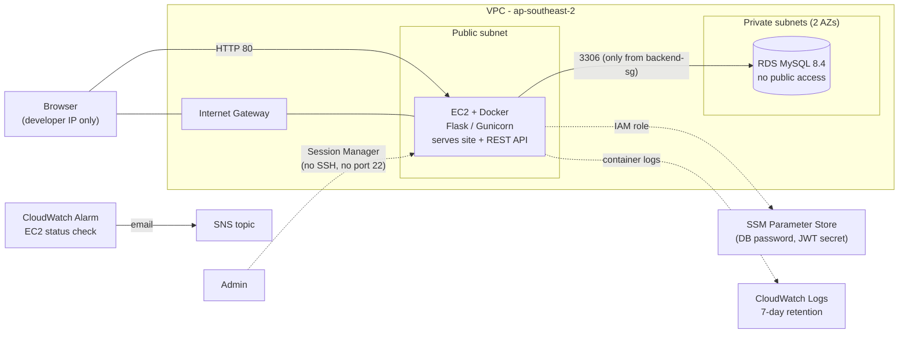

# Credit Book: a three-tier app on AWS

A small web app for shopkeepers to track **udhaar** (what customers owe them), built and deployed by hand on AWS as a hands-on cloud engineering project. The app is intentionally simple. The focus of this repo is the **cloud architecture, security and operations** around it.

> **Status:** deployed and working in `ap-southeast-2` (Sydney). Built to stay well inside a small personal budget, so it is torn down when not in use. See [docs/cost.md](docs/cost.md).

## Architecture



**In one sentence:** the browser talks to one Flask container on EC2; the container reads secrets from Parameter Store using an IAM role and talks to a MySQL database that sits in private subnets and accepts connections only from the backend's security group.

More detail: [docs/architecture.md](docs/architecture.md)

## Tech stack

| Layer | Technology |
|---|---|
| Frontend | HTML, CSS, vanilla JavaScript (served by Flask) |
| Backend | Python 3.12, Flask, Gunicorn, Docker |
| Database | Amazon RDS for MySQL 8.4 (private subnets) |
| Auth | bcrypt password hashes, JWT (HS256, 8-hour expiry) |
| AWS | VPC, subnets, Internet Gateway, route tables, security groups, EC2, RDS, IAM, SSM Parameter Store, SSM Session Manager, CloudWatch Logs and Alarms, SNS |

## What the app does

- Sign up and log in
- Add customers
- Record **credit given** and **payments received** for each customer
- Show each customer's balance and a "total to collect" figure
- Every user sees only their own data (ownership is checked on every request)

API reference: [docs/api.md](docs/api.md)

## Security design

- **Database is private.** It sits in private subnets, "Publicly accessible" is off, and its security group allows port 3306 **only from the backend's security group**.
- **No SSH.** Server access is through AWS Systems Manager Session Manager. There is no port 22 rule and no key pair to lose.
- **No secrets in code or in Git.** The DB password and JWT signing key are SecureString parameters in Parameter Store. The EC2 instance reads them through an **IAM role** with a narrow inline policy.
- **Least-privilege IAM.** The role can read only the `/creditbook/*` parameters and write only to one log group.
- **Passwords are hashed with bcrypt**, never stored or logged in plain text. Login errors are identical for "wrong email" and "wrong password".
- **SQL injection:** every query uses parameters (`%s` placeholders).
- **Input validation:** email format, password length (8 to 72 bytes, the bcrypt limit), money amounts as `Decimal` with 2 decimal places.
- **Broken-access-control check:** changing a customer ID in the URL to someone else's returns `404`.
- **Firewall:** port 80 is open only to the developer's own IP address, not to the world.

Known gaps and what I would add: [docs/security.md](docs/security.md)

## Monitoring

- Container output (including one line per HTTP request) goes to **CloudWatch Logs** (`/creditbook/backend`, 7-day retention to cap cost).
- A **CloudWatch alarm** watches the EC2 status check and sends an email through **SNS** if it fails.

## Cost control

Designed around a hard budget ceiling:
- No NAT Gateway, no load balancer, single small instances.
- Short log retention, everything easy to stop, and a documented teardown order.
- Estimated running cost is about **$0.035/hour** for EC2 and RDS together.

Details: [docs/cost.md](docs/cost.md)

## Repository layout

```
backend/        Flask API, Dockerfile, requirements
frontend/       index.html, style.css, app.js (single-page UI)
database/       schema.sql (reference schema)
docs/           architecture, security, cost, deployment, API, troubleshooting
deploy.sh       one-command redeploy on the EC2 server
```

## Deploying

Step-by-step build and teardown instructions: [docs/deployment.md](docs/deployment.md)

## Known limitations and roadmap

Honest list of what this project does **not** do yet:

| Limitation | What I would do next |
|---|---|
| HTTP only (no TLS) | CloudFront with a free certificate, or ALB + ACM + a domain |
| Single EC2 instance, single region | Application Load Balancer + Auto Scaling group |
| Single database instance | Multi-AZ RDS and automated backup review |
| Infrastructure created by hand in the console | Rebuild as Terraform / CloudFormation |
| Manual deploys (`deploy.sh`) | GitHub Actions pipeline that builds and pushes an image |
| App connects as the DB admin user | Create a dedicated least-privilege database user |
| No rate limiting on login | Add throttling / AWS WAF |

**CloudFront:** I designed the CloudFront + private S3 setup (documented in [docs/cloudfront-design.md](docs/cloudfront-design.md)), but AWS blocked creating distributions on my new account pending account verification, so the app is served directly from EC2 for now.

## Troubleshooting log

Real problems hit while building this, with cause and fix: [docs/troubleshooting.md](docs/troubleshooting.md)

<!--
Screenshots: add after the final run, then uncomment.


-->

## Author

Mir Mohammad Hashim. Building toward a junior cloud engineer role.
