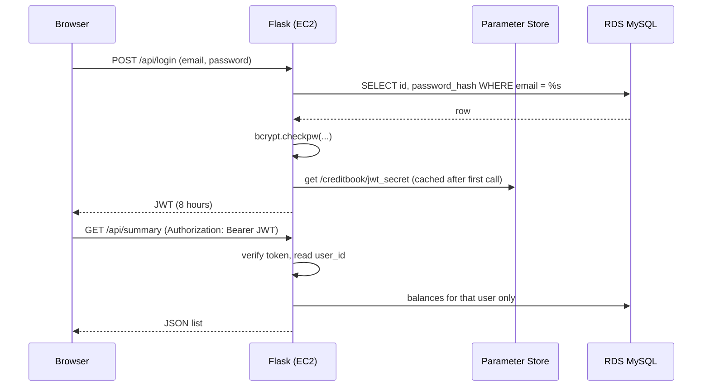

# Architecture

## Components

| Component | Purpose |
|---|---|
| VPC `credit-book-vpc` | Private network for everything |
| 2 public subnets (`10.0.1.0/24`, `10.0.2.0/24`) | Hold the EC2 server; route to the Internet Gateway |
| 2 private subnets (`10.0.11.0/24`, `10.0.12.0/24`) | Hold the database; **no route to the internet** |
| Internet Gateway | Lets the public subnet reach the internet |
| EC2 instance (Amazon Linux 2023) | Runs one Docker container: Gunicorn + Flask |
| RDS MySQL 8.4 | Stores users, customers and entries |
| DB subnet group `credit-book-db-subnets` | Tells RDS to use the two private subnets (two Availability Zones) |
| SSM Parameter Store | Holds `/creditbook/db_password` and `/creditbook/jwt_secret` as SecureStrings |
| IAM role `ec2-backend-role` | Gives the EC2 instance Session Manager access, parameter read access, and log write access |
| CloudWatch Logs + Alarm + SNS | Log storage and email alert on EC2 status-check failure |

## Security groups (the firewall chain)

| Security group | Inbound rule | Meaning |
|---|---|---|
| `backend-sg` | TCP 80 from the developer's IP `/32` | Only my own IP can open the site |
| `database-sg` | TCP 3306 from `backend-sg` | Only the backend can talk to the database |

No rule opens port 22. The database never accepts traffic from the internet or from any IP address directly. It accepts traffic only from members of `backend-sg`.

## Request flow: logging in

## Design decisions and trade-offs

**No NAT Gateway.** A NAT Gateway has an hourly charge that is large for a learning budget. The EC2 server is in a public subnet, so it reaches Parameter Store, CloudWatch and Session Manager over the Internet Gateway using its public IP. The database never needs outbound internet access, so the private subnets have no route out.

**Database in private subnets, backend in a public subnet.** The backend is the only component that must be reachable. Putting it in the public subnet avoids a NAT Gateway or VPC endpoints, and its security group still restricts who can connect. The trade-off is that the server has a public IP. Production would use a load balancer in the public subnet and the app in a private subnet.

**Session Manager instead of SSH.** No inbound port, no key pair, and every session can be audited.

**Secrets in Parameter Store, not environment variables or code.** The container receives only the DB hostname. Secrets are fetched at runtime and cached in memory. This is simpler and cheaper than Secrets Manager for this project (Secrets Manager adds rotation, which would be the next step).

**Flask serves the frontend.** This keeps the setup to one server. The planned alternative (private S3 + CloudFront) is in [cloudfront-design.md](cloudfront-design.md).

**Balance computed in SQL.** The balance is `SUM(credit) - SUM(payment)` calculated by the database from the entries, not a stored column. It cannot drift out of sync with the history.

## Data model

See [../database/schema.sql](../database/schema.sql). Three tables: `users` → `customers` → `entries`. Money uses `DECIMAL(10,2)`, never floating point.
