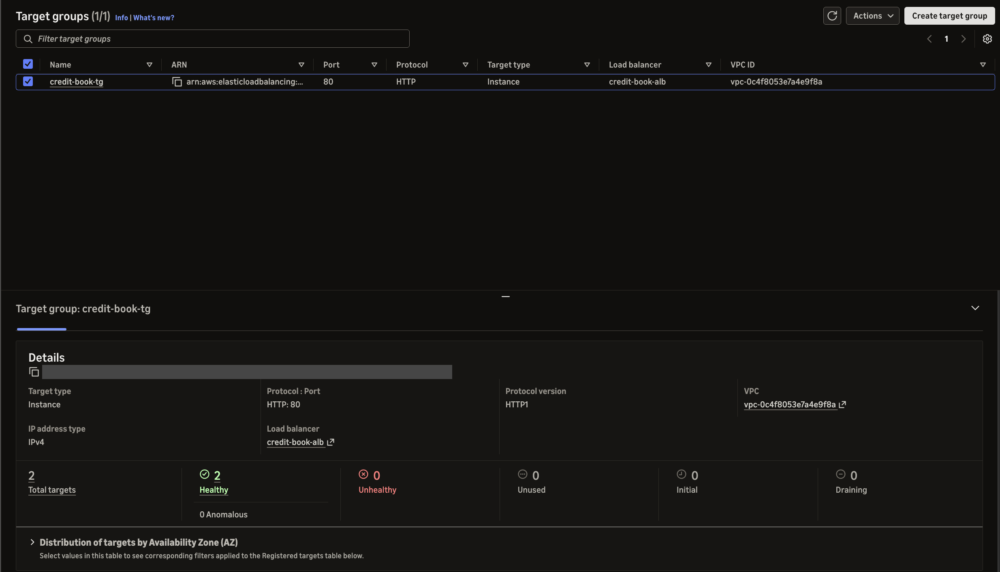
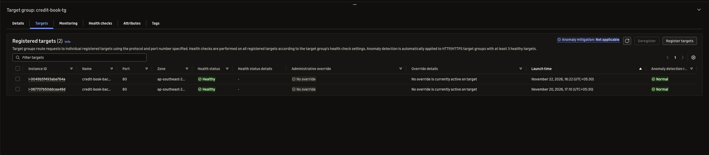
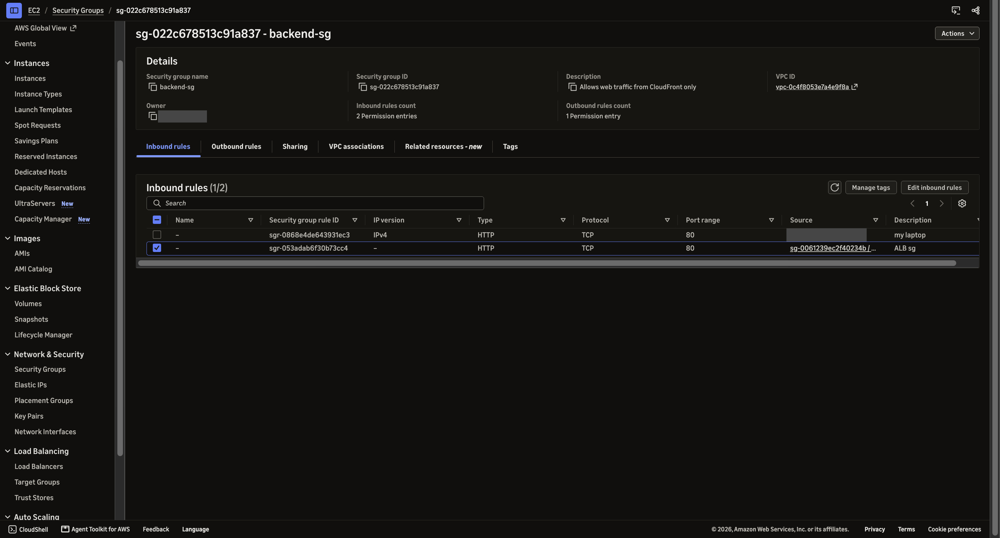

# Load balancer lab: two servers behind an ALB

I added an Application Load Balancer (ALB) in front of two copies of the backend as a short, time-boxed lab, then removed it again to avoid cost. The standing project still runs on one server (see [architecture.md](architecture.md)). This page records what I built, what I tested, and what went wrong.

## What I built

```
Browser -> ALB (public subnets, 2 AZs) -> target group -> EC2 #1 (ap-southeast-2a)
                                                       -> EC2 #2 (ap-southeast-2b)
                                                       -> RDS MySQL (private subnets)
```

| Piece | Setting |
|---|---|
| Server image | An AMI taken from the working backend, so the second server started identical (Docker, app code, container that restarts on boot) |
| Second server | `credit-book-backend-2`, same instance type, public subnet in `ap-southeast-2b`, same `ec2-backend-role` |
| Target group | `credit-book-tg`, HTTP 80, health check `GET /api/health`, healthy after 5 passes, unhealthy after 2 failures |
| Load balancer | `credit-book-alb`, internet-facing, both public subnets, HTTP 80 listener forwarding to the target group |
| Firewall | `alb-sg` allowed HTTP from my IP only. `backend-sg` got a rule allowing HTTP from `alb-sg` (security group to security group) |

## Screenshots

**Target group: both servers healthy**



**Targets tab: one server in each Availability Zone, both Healthy**



**`backend-sg` allowing HTTP from the ALB's security group (the "ALB sg" rule) next to my own IP rule**



The account ID and my IP address are blurred.

## Why it worked without code changes

- Login uses JWT, so any server can verify a token. No sticky sessions were needed.
- Both servers read the same secrets from Parameter Store and use the same RDS database.

## What I tested

- Opened the ALB DNS name and used the full app through it.
- Stopped one server. The target group stopped using it and showed its state as **Unused** (a stopped instance shows as Unused, not Unhealthy).

## Problems I hit

| Problem | Cause | Fix |
|---|---|---|
| Launch wizard defaulted to a new security group with SSH (22) open to `0.0.0.0/0` | The wizard's default | Chose the existing `backend-sg` instead |
| New server would have had no AWS permissions | An AMI does not carry the IAM instance profile | Attached `ec2-backend-role` under Advanced details |
| ALB returned **504 Gateway Timeout** | `backend-sg` only allowed my IP, so the ALB's requests were dropped | Added an inbound HTTP rule on `backend-sg` with `alb-sg` as the source |
| Stopped server showed **Unused**, not Unhealthy | Expected behaviour for a stopped instance | Read the target's health status details |

## Cost and teardown

An ALB bills by the hour plus capacity units, and the lab also ran a second server. I ran it for a couple of hours and then deleted: ALB, target group, second instance, AMI and its snapshot, `alb-sg`, and the `backend-sg` rule that referenced it.

## What I would do next

- Keep the app servers in private subnets with only the ALB public (needs a NAT Gateway or VPC endpoints, which cost extra).
- Add HTTPS with ACM and a domain.
- Replace the hand-made second server with an Auto Scaling group and launch template.
- Build all of this in Terraform.
